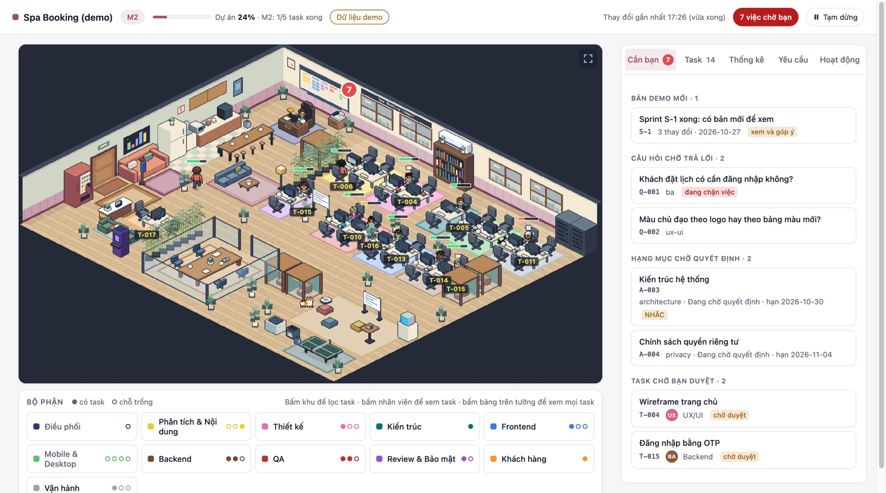
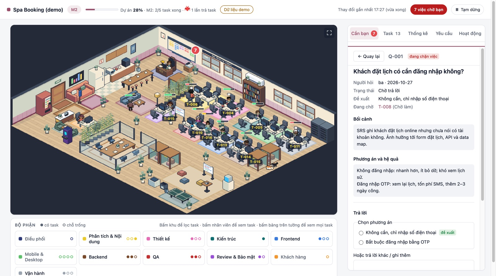
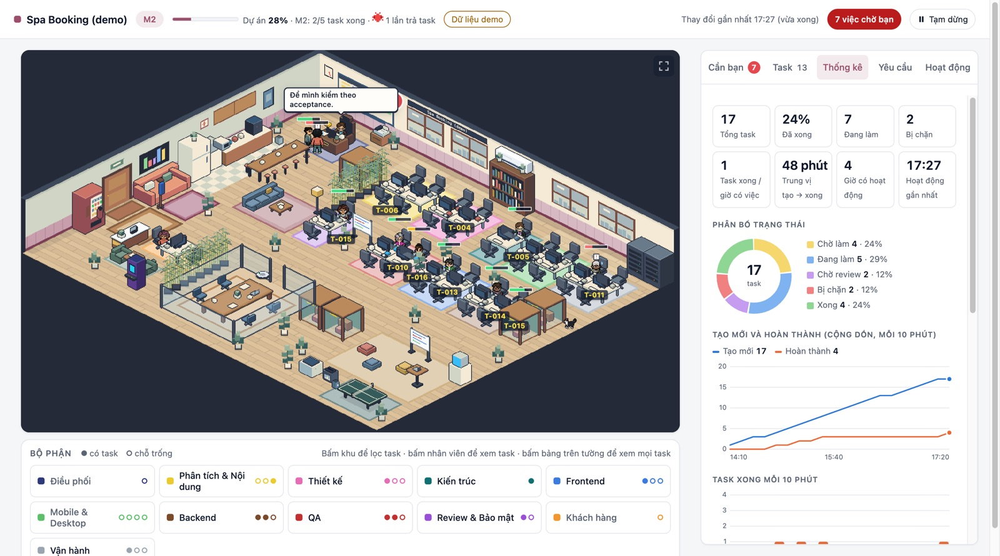

# Agent Product Studio: AI agents that build your website or app, with you in control

**[▶ Try the live demo](https://quangtrung2503.github.io/agent-product-studio-demo/)** · no install, runs in your browser · [Tiếng Việt](#tiếng-việt)

**Agent Product Studio** is a multi-agent AI software development framework. A team of AI agents takes a digital product from idea to launch:

- products: websites, web apps, mobile apps (iOS, Android) and desktop apps;
- stages: requirements, UX/UI design, architecture, coding, code review, security review, testing, deployment and handover.

You stay in charge without managing anyone. You answer questions, approve milestones and confirm risky actions, all from a visual **pixel-art office dashboard**.

## Why teams choose Agent Product Studio

- **A full AI product team, not a chatbot.** It has 14 specialised AI agents:
  - business analyst, UX/UI designer, content writer and solution architect;
  - frontend, mobile, desktop and backend developers;
  - code reviewer, QA tester, security engineer, DevOps and support;
  - an account manager for client projects.

  An AI project manager (Orchestrator) plans the sprints, assigns tasks, reviews the work and merges it.
- **Human-in-the-loop by design.** You make only four kinds of decisions: answer questions, approve, confirm irreversible actions, and send requests. Everything else runs autonomously.
- **Safe by construction.** These limits are enforced by Git hooks, not just by prompts:
  - AI never writes your decisions;
  - it never commits to your main branch, never deploys to production and never uses paid services without your explicit "Yes";
  - it never commits secrets;
  - code reaches a work branch only after independent review and passing checks.
- **Real software process.** Work moves through gated milestones: requirements (SRS), design, sprints, UAT and go-live. It also includes:
  - change requests after each gate;
  - traceability from user story to task to test case;
  - per-agent ownership zones that prevent conflicts;
  - token and time tracking per task.
- **Works on new and existing codebases.** Start a project from scratch, or adopt an existing repository. In that case the agents reverse-engineer the current architecture, requirements and test baseline first, without changing the code's behaviour.
- **Bring your own AI tool.** Best with Claude Code (desktop or CLI). It also works with Codex, Antigravity, Cursor and any tool that reads `AGENTS.md`.
- **Cost control.** Choose a model preset per role (`balanced`, `economy`, `budget`, `max`) and see token usage per milestone.

| Answer a question in one click | Track progress like Jira |
|---|---|
|  |  |

## How it works

1. **Brief.** You describe your product, or let the business-analyst agent interview you.
2. **Requirements (M1).** The agents brainstorm the scope and write an SRS. You approve it.
3. **Design (M2).** The agents produce user flows, a clickable UI preview, content and the technology choices. You approve them.
4. **Sprints (M3).** Developer agents build in parallel. Every task is checked by an independent reviewer, a security review and automated tests. You get a demo at the end of each sprint.
5. **UAT and go-live (M4–M5).** QA prepares an acceptance checklist and DevOps prepares a runbook. Production deploys only when you say yes.

## Who it is for

- **Agencies and freelancers** delivering client websites and apps faster, with approval packages, quotes and change-request pricing built in.
- **Founders and product owners** who want an MVP built by AI without losing control of scope, cost or quality.
- **Engineering teams** adopting AI agents on an existing codebase with guardrails.

## Get access

The framework source is private. **[Open the demo](https://quangtrung2503.github.io/agent-product-studio-demo/)** to see the office dashboard with sample data. For a licence, a walkthrough or a custom setup, contact [@quangtrung2503](https://github.com/quangtrung2503).

---

## Tiếng Việt

### Agent Product Studio: đội agent AI làm website, app cho bạn, bạn chỉ duyệt

**[▶ Xem demo trực tiếp](https://quangtrung2503.github.io/agent-product-studio-demo/)**, không cần cài đặt.

**Agent Product Studio** là bộ khung phát triển phần mềm bằng nhiều agent AI. 14 agent chuyên môn (BA, thiết kế UX/UI, nội dung, kiến trúc sư, lập trình web, mobile, desktop, backend, review code, kiểm thử, bảo mật, DevOps, hỗ trợ, quản lý khách hàng) cùng một **AI quản lý dự án** tự làm website, app mobile và app desktop từ yêu cầu đến go-live.

Bạn không phải giao việc hay nhớ bước tiếp theo. Bạn chỉ **trả lời câu hỏi, duyệt và xác nhận** trên văn phòng pixel trực quan.

- **An toàn:** AI không ghi thay quyết định của bạn, không đụng nhánh chính, không deploy production hay dùng dịch vụ trả phí khi bạn chưa đồng ý. Các giới hạn này được chặn bằng máy.
- **Quy trình chuẩn:** SRS, thiết kế, sprint, UAT và go-live, có gate duyệt và Change Request. Mỗi task đều qua review độc lập và kiểm thử tự động.
- **Dùng cho dự án mới và dự án đã có code:** với dự án đã có code, agent đọc ngược code ra tài liệu trước khi làm tiếp.
- **Kiểm soát chi phí:** chọn mức model cho từng vai, theo dõi token theo từng milestone.
- **Phù hợp với:** agency, freelancer làm web/app cho khách; founder cần MVP nhanh; đội kỹ thuật muốn đưa AI agent vào dự án có sẵn.

Mã nguồn bộ khung hiện ở chế độ riêng tư. Liên hệ [@quangtrung2503](https://github.com/quangtrung2503) để được demo, mua bản quyền hoặc hỗ trợ triển khai.

Keywords: AI agents, multi-agent framework, AI software development team, autonomous coding agents, human-in-the-loop AI, AI project manager, Claude Code agents, build website with AI, build mobile app with AI, AI web development agency tool, công cụ AI làm website, đội AI lập trình.
